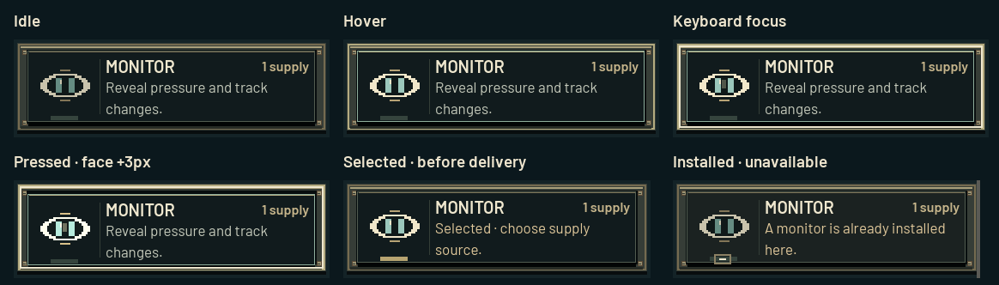

> Historical report for the prior delivery-time Monitor rule. The current rule is `monitor-next-round-1`: first reading at the next round start. Screenshots and test counts below describe the earlier version. See the README for current mechanics.

# Mechanical tower controls and persistent Monitor

The three equal-size controls use original 24-pixel lens, eye and shield artwork. Iron housings, recessed faces, brass bevels, rivets and small corner stains are drawn directly by Godot. All material wear stays outside the text and icon areas. The fixed housing never moves; the face moves down three pixels while held. Hover and keyboard focus illuminate the rim and run one 240 ms icon highlight. Reduced motion suppresses that animation while retaining immediate focus/press feedback.

[Open the screenshot gallery](screenshots/tower-controls/review.html) · [State close-ups](screenshots/tower-controls/states.png) · [7-second interaction recording](screenshots/tower-controls/interaction.mp4)

## Delivery and information

Selection is explicitly marked in the source picker. It does not reserve supplies or install anything. Source choice and route preview remain reversible. Only confirmation reserves supplies; only arrival applies the action. Duplicate confirmation and duplicate Monitor installation remain guarded.

Monitor still costs 1 supply. Arrival reads the actual current pressure (0, 1 or 2), publishes a Monitor initial observation, and installs it for the scenario. Unchanged pressure retains its reading; later pressure changes update it and create change alerts. It neither cures nor shields. Both AI roles receive only public information through the same whitelist. Verify remains an explicitly dated snapshot. Overrun remains the dominant warning.

The shared eye appears in action controls, installed tower markers, pressure labels, inspector readings and Monitor observation cards. Map labels reserve space for the icon and avoid towers, roads, bridges and neighboring labels. Depot stocks remain visible. English and Simplified Chinese controls, disabled reasons and readings use the existing font fallback.

The inspector footprint is unchanged. All three controls fit its inner visible area at 1440×900 and 1200×800 in both languages. Verification history follows the controls so it cannot push the primary controls down. Longer observation histories remain scrollable. No scenario maps, routes, main-menu behavior, action costs or sound dependencies changed.

## Versioning and balance

- Rule: `monitor-current-1`; observation format: `observations-2`.
- Export schema 8: initial Monitor observations have `type: MONITOR`, `kind: initial`, `pressure`, `target`, `round`; changes have `kind: change`, `old`, `new`. Historical change observations without a kind still render.
- Initial delivery logs `MONITOR_INSTALLED` followed by `MONITOR_OBSERVATION`. Resolution retains `MONITOR_ALERT`. Round summaries include Monitor observations from that round.
- AI context `cascade-context-4`, local support `support-1.3.0`, provider prompt `cascade-zh-5`.
- New public sessions use schema 10 / `cascade-public-10`. Existing queued records keep their stored metadata; schemas 8 and 9 remain accepted for historical records. Old context versions remain rejected rather than being silently reinterpreted.

**Unresolved balance issue:** at the same 1-supply price, Monitor now provides Verify's delivery-time information plus future updates. Verify remains available. No balancing adjustment was made.

## Verification

All tests used synthetic state and mocked model transports; no paid model calls.

| Check | Result |
|---|---|
| Core rules and strategies | 567 checks passed |
| Monitor arrival, persistence, records, privacy, duplicate installation, dated Verify | 38 checks passed |
| Public AI projection and fixed messages | 2,004 checks passed |
| Scenario outcome fixtures | 367 checks passed |
| Bridge/action regression | 848 checks passed |
| Existing source selection, route preview, cancellation, duplicate confirmation and delivery tests | 737 checks passed |
| Real mouse input, control-state captures and inner inspector bounds at both sizes/languages | 72 checks passed |
| Real keyboard and emulated touch input, reduced motion and disabled activation | 13 checks passed |
| Full pressure-label collision and pixel privacy checks across four scenarios, both sizes/languages | 2,252 checks passed |
| Python backend, native save queue, forms, and intercepted outbound AI context | 71 tests: 60 passed, 11 PostgreSQL-dependent tests skipped |

The broad legacy `test_ui_improvements.gd` runner throws in its unrelated access-code fixture because it expects Play to open the retired code-entry screen. Its terrain/source assertions completed without failures; the source portion was also run independently with `test_tower_delivery.gd`, which passes. The main menu was not changed to satisfy that obsolete fixture.

One first-pass pixel privacy comparison differed during initial rendering; reruns passed. The dedicated privacy test now requires two identical frames before comparing hidden-state variants, avoiding startup layout/font settling. Final stable-frame checks pass.

## Reproduce

Use the installed Godot executable with `--path . --script res://tests/<name>.gd -- --offline-tests`.

- `test_monitor_current.gd`: domain and record assertions (can run `--headless`).
- `test_tower_delivery.gd`: source/delivery regression (can run `--headless`).
- `test_tower_input.gd`: keyboard, touch and reduced-motion checks (windowed).
- `test_monitor_map.gd`: rendered privacy and label bounds (windowed).
- `capture_tower_controls.gd`: captures all states and records 15 fps real-engine frames in `build/tower-controls/frames` (windowed).

Encode those frames with `ffmpeg -framerate 15 -i build/tower-controls/frames/%04d.png -c:v libx264 -pix_fmt yuv420p -crf 20 -movflags +faststart docs/screenshots/tower-controls/interaction.mp4`, then run `tools/build_tower_review.py` using a Python runtime with Pillow. The gallery builder checks every linked file.

Before captures were taken from the original working tree before changes. After captures and the recording come from the actual rendered game, not mockups. Historical exports and baselines have not been rewritten. Nothing was committed, pushed, deployed, or changed in cloud infrastructure.
